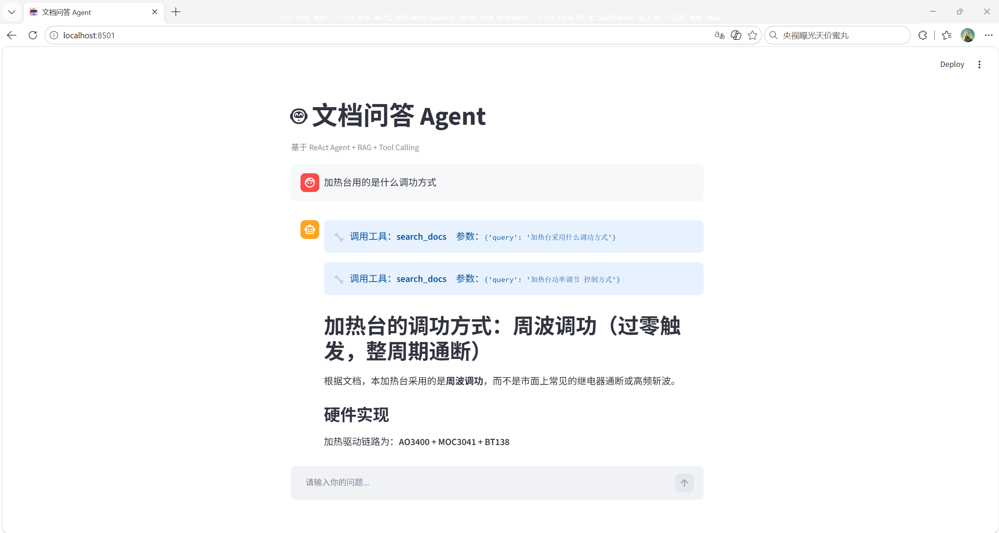

# 技术文档智能问答 Agent

> 作者：大羊习习 | 2026.11 | [GitHub](https://github.com/DYXX219)

基于 **ReAct Agent + RAG** 的本地文档问答系统，可针对私有技术文档进行精准问答，并由大模型自主判断是否需要检索工具，支持工具调用过程可视化。

## 功能特性

- **自主决策**：Agent 根据问题类型自主决定是否调用检索/计算工具，闲聊不触发检索
- **RAG 检索增强**：文档切分 → BGE 中文向量化 → FAISS 相似度检索 → 上下文增强生成
- **幻觉抑制**：Prompt 约束模型仅基于检索内容作答，文档外问题明确回答"不知道"
- **过程可视化**：界面实时展示 Agent 的工具调用轨迹与检索到的参考片段
- **本地化部署**：Embedding 模型本地运行，不依赖外部向量化服务

## 技术栈

| 层次 | 技术 |
|---|---|
| 编排框架 | LangChain、LangGraph |
| 大模型 | DeepSeek-Chat（OpenAI 兼容接口） |
| 向量化 | BAAI/bge-small-zh-v1.5 |
| 向量库 | FAISS |
| 界面 | Streamlit |

## 系统架构

```text
用户提问
   ↓
ReAct Agent（LLM 推理决策）
   ├─ 需要资料 → 调用 search_docs 工具 → FAISS 检索 Top-3 片段 → 拼入上下文
   ├─ 需要计算 → 调用 calculator 工具
   └─ 无需工具 → 直接回答
   ↓
生成答案 + 展示工具调用轨迹
```

## 快速开始

1. 安装依赖

```bash
pip install -r requirements.txt
```

2. 配置密钥（在根目录创建 `.env` 文件）

```text
DEEPSEEK_API_KEY=你的Key
```

3. 准备知识库文档，命名为 `mydoc.txt` 放在根目录

4. 启动

```bash
streamlit run agent_app.py
```

其他版本：

- `streamlit run app.py` —— 基础 RAG 版（固定检索流程，无工具调用决策）
- `python rag.py` —— 命令行版，适合快速调试检索效果
- `python test.py` —— 测试 API Key 是否可用

## 效果示例



## 项目结构

```text
my-rag/
├── agent_app.py            # 主程序：Agent 版本（ReAct + 工具调用 + Streamlit 界面）
├── app.py                  # 基础 RAG 版本（固定检索流程，用于对比）
├── rag.py                  # 命令行版 RAG（无界面，便于调试）
├── test.py                 # API 连通性测试脚本
├── mydoc.txt               # 知识库文档（技术资料）
├── screenshots/            # 界面截图
│   └── demo.png
├── requirements.txt        # 核心依赖
├── requirements-lock.txt   # 完整依赖锁定版本
├── README.md
├── .gitignore              # 排除 .env / .venv 等
└── .env                    # API 密钥（本地配置，不提交到仓库）
```

## 说明

本项目为个人学习实践项目，用于验证 RAG 与 Agent 编排的工程实现。

作者：大羊习习｜联系：2159213372@qq.com
